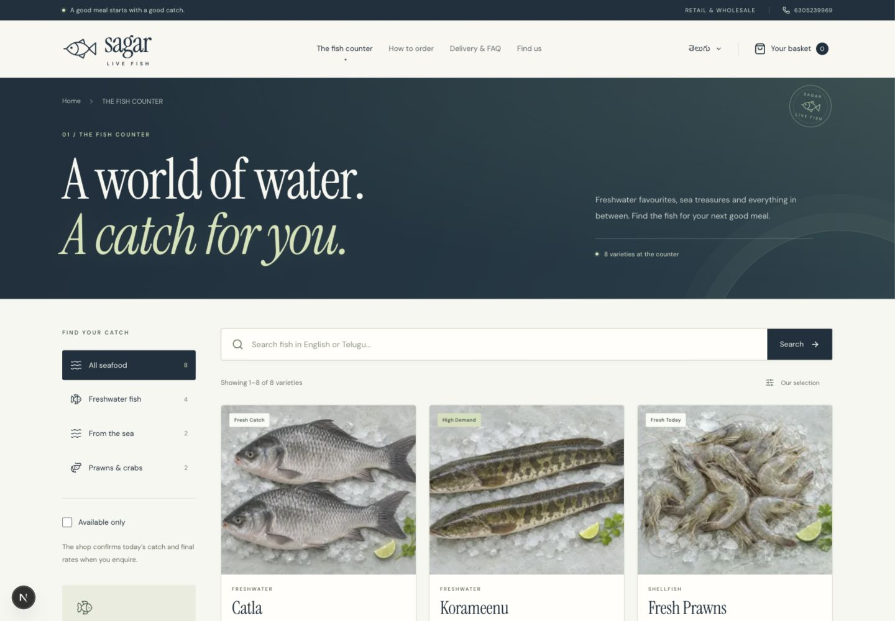

# Sagar Live Fish

A bilingual seafood catalogue and owner dashboard for a local business. Customers browse in English or Telugu, choose preparation and quantity, and prepare an order enquiry for WhatsApp. The owner maintains one shared catalogue of prices and availability.

**[View the public storefront](https://sagar-live-fish.dimilianilgowtham.chatgpt.site)**



## Features

- Search, category/stock filters, sorting, pagination, and shareable catalogue URLs.
- Product detail pages, preparation choices, quantity controls, and a persistent basket that reconciles catalogue changes.
- WhatsApp enquiry handoff for retail, wholesale, and delivery questions.
- Protected owner tools for bilingual products, daily rates, stock, image uploads, archive/restore, and rate cards.
- SQLite transactions, revision conflict checks, append-only change history, and verified database backups.
- Password hashing, expiring/revocable sessions, origin validation, sign-in throttling, and re-encoded photo uploads.

## Stack

Next.js 16 · React 19 · TypeScript · Node.js SQLite · Sharp · Docker

## Run locally

Requires Node.js **22.13+**; Node.js 24 is used by the Dockerfile.

```sh
npm ci
npm run dev
```

Open `http://localhost:3000`. For a fresh development database, open `/admin` and create the first owner with a password of at least 12 characters. No default password is included. Public owner registration is disabled in production.

The private database defaults to `.data/sagar.sqlite`. Keep `.data/`, environment files, uploaded customer/owner data, and backups out of Git. Public images included here are illustrative assets; see [image documentation](docs/image-assets.md).

## Verification

```sh
npm run check
```

Verified on **18 November 2026** with the existing local dependencies: **59 tests and 2 stress tests passed**, along with ESLint, TypeScript, and the production build. The stress checks use disposable databases and exercise 400 committed edits across four database clients. This is a local database result, not a production user-capacity claim. A fresh dependency installation was not verified in the restricted execution environment.

HTTP integration and load harnesses are also included. They require an isolated test server and fixture database; use the safeguards in the test files and [deployment guide](docs/launch.md).

## Deployment and scope

This repository contains the **Node/SQLite implementation**. The linked public storefront runs a separate cloud implementation; the local test results above describe this repository. Production deployment of this version requires HTTPS, one Node application replica, and a private persistent disk. A static export or ephemeral serverless filesystem cannot provide the owner dashboard.

The site prepares enquiries. The shop confirms availability, final weight, prices, and pickup/delivery directly. Payments and order tracking are outside the implemented scope.

- [Architecture](docs/architecture.md)
- [Deployment, owner setup, backups, and QR exports](docs/launch.md)
- [Verification details](docs/verification.md)

## Repository map

| Path | Purpose |
| --- | --- |
| `src/app/` | Customer routes, owner workspace, API handlers |
| `src/components/` | Catalogue, ordering, bilingual interface, admin UI |
| `src/lib/server/` | Authentication, SQLite, media, catalogue, backups |
| `src/data/` | Initial product and public business information |
| `tests/` | Behaviour, persistence, security, and disposable stress checks |
| `scripts/` | Production launcher, owner setup, backups, QR exports |
