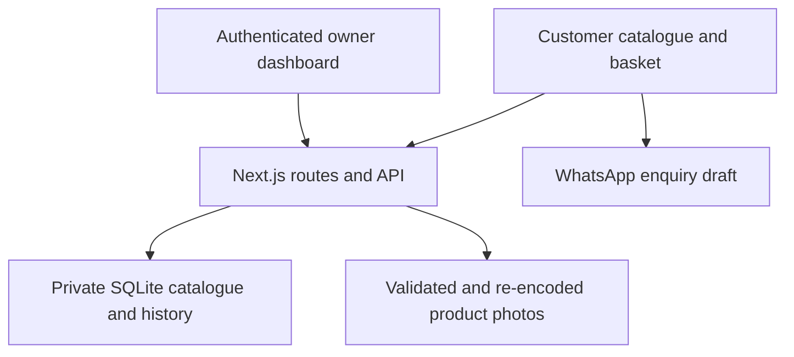

# Sagar Live Fish architecture

Catalogue reads are public. Owner mutations require authenticated sessions and a valid request origin. Revision checks reject stale edits; catalogue changes and their history are written in one transaction. Customers refresh catalogue state and reconcile saved baskets with current stock and rates.

The database also stores owner credentials as hashes, hashed session tokens, and uploaded media. It belongs on a private persistent volume. Backups use SQLite's consistent backup mechanism. The app runs as one server replica.

The WhatsApp handoff prepares a message for the customer to review and send. It does not confirm an order or process a payment. The separate cloud-hosted storefront is not built from this SQLite runtime.
